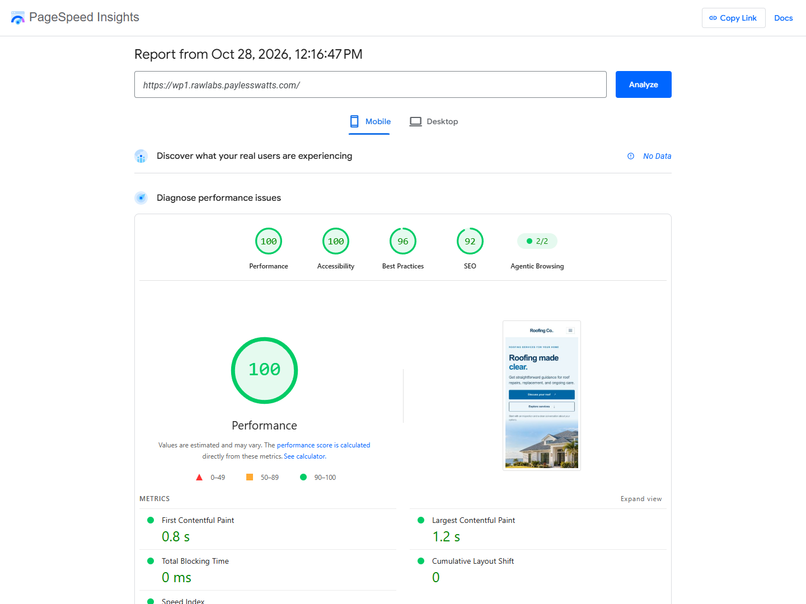
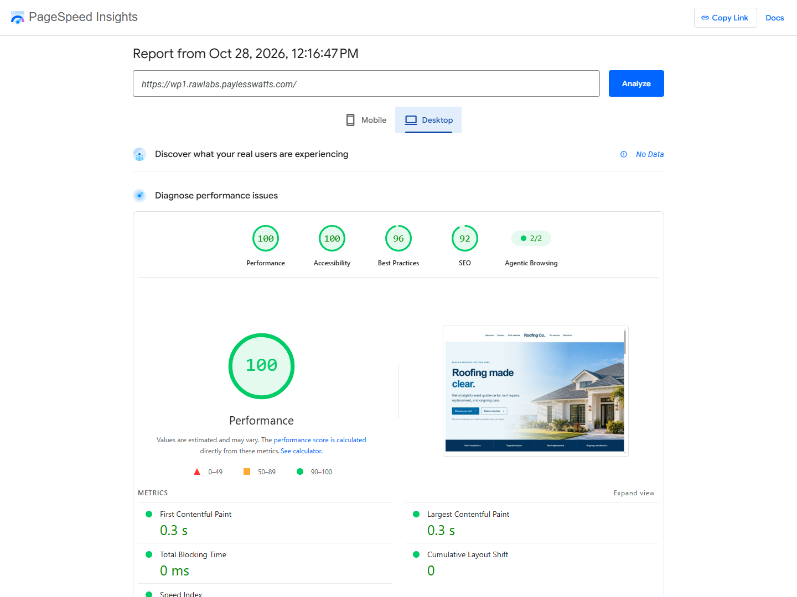

  

  
  

  
  

<strong>100 mobile performance · 100 desktop performance · captured October 28, 2026</strong>

<a href="https://rawpowered.github.io/BlueRoof-WP-Theme-Showcase/">Open the case study</a> · <a href="https://wp1.rawlabs.paylesswatts.com/">Open the hosted WordPress demo</a> · <a href="https://rawpowered.github.io/BlueRoof-WP-Theme-Showcase/demo.html">Open the static page preview</a>

# BlueRoof WP Theme

BlueRoof is a custom classic WordPress theme concept for roofing businesses. It organizes the homepage around inspections, repairs, replacement, roof materials, process, questions, and estimate requests.

This public repository presents the product, design decisions, live previews, and performance evidence. Theme root files remain in a separate private repository.

## What the design supports

- A homeowner-focused service journey with direct estimate and service links.
- Responsive layouts for desktop and mobile.
- A centered logo with balanced split navigation, custom logo support, and compact scroll header behavior.
- Service sections for inspection, repair, replacement, and maintenance.
- Material imagery for asphalt shingles, clay tile, concrete tile, metal, and low-slope roofing.
- WordPress page, post, archive, search, comments, sidebar, and 404 templates.
- Customizer support for a header action and a homepage pattern.

## Technology

| Layer | Used for |
| --- | --- |
| PHP 8.0+ | WordPress theme templates and setup |
| WordPress 6.6+ | Theme framework, menus, Customizer, and content patterns; live demo checked on 7.1.3 |
| HTML5 | Semantic content and accessible navigation |
| CSS3 | Responsive layouts, visual states, and reduced-motion behavior |
| Vanilla JavaScript | Deferred menu and scroll-header interactions |
| WebP | Responsive hero and roof-material imagery |

No page builder is required by the theme design. The hosted test homepage was populated on a fresh WordPress install without added plugins.

## Performance evidence

The hosted homepage scored 100 Performance in a single PageSpeed Insights Lighthouse run on both device profiles. The evidence was captured on October 28, 2026 at 12:16:47 PM CDT. The dated [performance record](performance/2026-10-28/README.md) includes the test setup, all category scores, timings, audit notes, and timestamped desktop and mobile screenshots.

The screenshots are shown at the top of this README so reviewers can inspect the underlying reports before reading the feature summary. PageSpeed reported no CrUX field data for the test URL, so the scores are lab measurements rather than a record of user traffic.

## Release stage and limitations

Version `0.1.0` is a design and development candidate. ThemeForest has not reviewed or approved it. Before a commercial submission, the project needs a clean-install and compatibility review, accessibility and translation passes, final image-rights review, complete documentation, and an explicit marketplace submission check.

The hosted report also logged a theme JavaScript asset error and a missing meta description. The JavaScript asset path needs correction and the live mobile menu needs a new interaction check. The preview contact form is disabled and stores no information.

Envato recommends a functional live preview that lets prospective buyers evaluate the theme's visual design and behavior. This case study keeps the screenshots, demo, stack, scope, and release status easy to review. [Envato item presentation guidance](https://help.author.envato.com/hc/en-us/articles/360000424863-Item-Presentation-Requirements).

## Preview and contact

- [Case study page](https://rawpowered.github.io/BlueRoof-WP-Theme-Showcase/)
- [Hosted WordPress demo](https://wp1.rawlabs.paylesswatts.com/)
- [Static roofing page preview](https://rawpowered.github.io/BlueRoof-WP-Theme-Showcase/demo.html)
- [Performance log](performance/2026-10-28/README.md)
- [Joseph Edwards on GitHub](https://github.com/RawPowered)

Design and development by [Joseph Edwards](https://github.com/RawPowered). Images and source are presented for portfolio review. This repository does not grant a reuse license.
