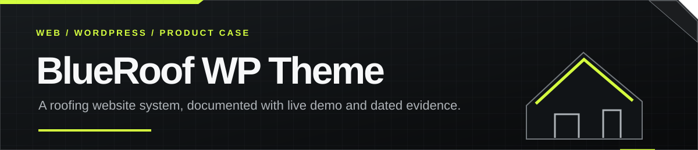
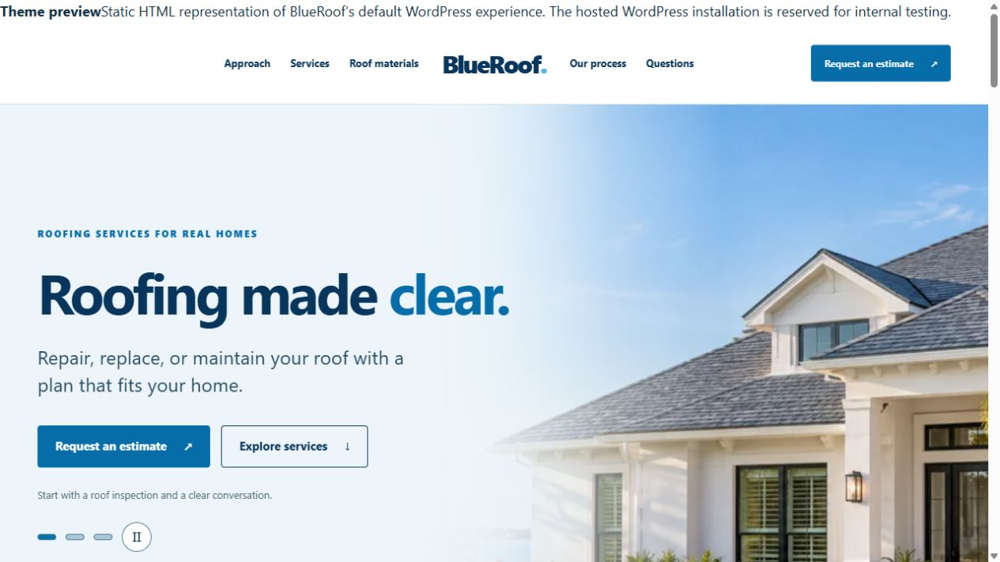
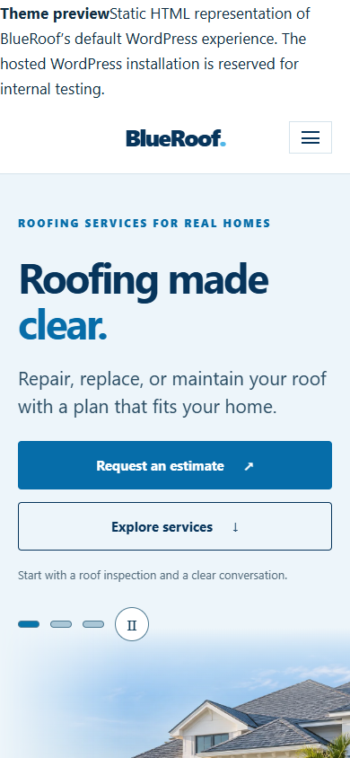
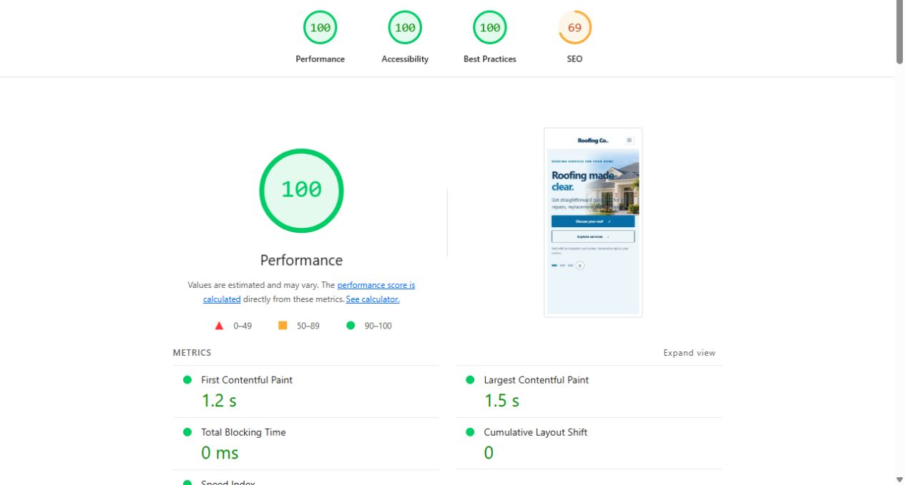
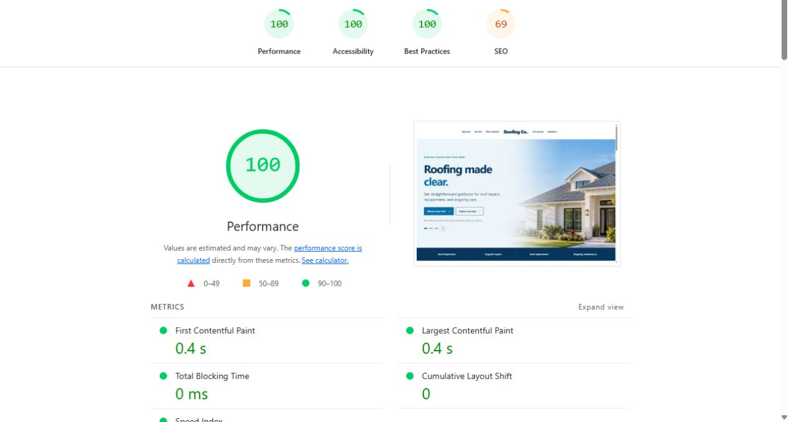
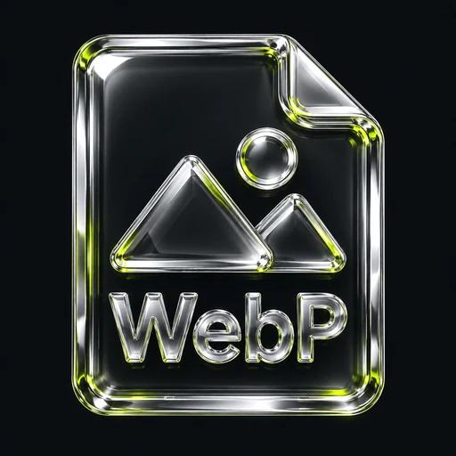

  

<strong>THE FIRST SCREEN / BLUE ROOFING CO.</strong>

  

<strong>FULL-PAGE PREVIEW / DESKTOP + MOBILE</strong>

  
  

  
  

<strong>100 mobile performance · 100 desktop performance · captured October 29, 2026</strong>

<a href="https://rawpowered.github.io/BlueRoof-WP-Theme-Showcase/">Open the case study</a> · <a href="https://rawpowered.github.io/BlueRoof-WP-Theme-Showcase/demo.html">Explore the preview</a>

# BlueRoof WP Theme

BlueRoof is a custom classic WordPress theme concept for roofing businesses. It organizes the homepage around inspections, repairs, replacement, roof materials, process, questions, and estimate requests.

This public repository presents the product, design decisions, HTML representation, and dated performance evidence. The representation reflects the theme's default WordPress experience. Theme root files remain in a separate private repository.

## What the design supports

- A homeowner-focused service journey with direct estimate and service links.
- Responsive layouts for desktop and mobile.
- A centered logo with balanced split navigation, custom logo support, and compact scroll header behavior.
- A three-photo hero with manual controls, a pause button, and restrained desktop parallax. Reduced motion preferences are respected.
- A clearly labeled sample reviews layout. A separate reviews plugin supports Google Places, a shortcode, and an optional Elementor widget when connected to a business profile.
- Service sections for inspection, repair, replacement, and maintenance.
- Material imagery for asphalt shingles, clay tile, concrete tile, metal, and low-slope roofing.
- WordPress page, post, archive, search, comments, sidebar, and 404 templates.
- Customizer support for a header action and a homepage pattern.

## Technology

<table>
  <tr>
    <td align="center" width="50%"> <strong>PHP 8.0+</strong> Theme templates and WordPress integration</td>
    <td align="center" width="50%"> <strong>WordPress 6.6+</strong> Menus, Customizer, and content patterns</td>
  </tr>
  <tr>
    <td align="center"> <strong>HTML5</strong> Semantic content and accessible navigation</td>
    <td align="center"> <strong>CSS3</strong> Responsive layouts and reduced motion support</td>
  </tr>
  <tr>
    <td align="center"> <strong>Vanilla JavaScript</strong> Navigation, hero slider, and scroll effects</td>
    <td align="center"> <strong>WebP</strong> Responsive roof imagery</td>
  </tr>
</table>

No page builder is required by the theme design. The hosted test homepage was populated on a fresh WordPress install without added plugins.

## Performance evidence

The current hosted WordPress test homepage scored 100 Performance, 100 Accessibility, and 100 Best Practices on both Lighthouse profiles. The dated [October 29 record](performance/2026-10-29/README.md) includes test conditions, timings, repeat runs, and timestamped screenshots. The internal test address is omitted from the public record.

The screenshots are shown at the top of this README so reviewers can inspect the result before reading the feature summary. These scores describe controlled lab runs. SEO scored 69 because the internal test site is deliberately blocked from indexing. The [October 28 record](performance/2026-10-28/README.md) remains available as an earlier baseline.

## Project status

Version `0.2.0` is installed and checked on WordPress. The hosted homepage exercises the new slider and parallax. The independent reviews plugin rendered its labeled sample cards under both BlueRoof and Sunlectric Solar. Live Google reviews await the owner's API credentials and Place ID.

The GitHub preview presents the default WordPress layout in HTML, including responsive navigation and scrolling behavior. Its contact form demonstrates the layout and does not submit information. Theme source is maintained privately.

## Preview and contact

- [Case study page](https://rawpowered.github.io/BlueRoof-WP-Theme-Showcase/)
- [HTML representation of the default WordPress experience](https://rawpowered.github.io/BlueRoof-WP-Theme-Showcase/demo.html)
- [Current hosted performance log](performance/2026-10-29/README.md)
- [Joseph Edwards on GitHub](https://github.com/RawPowered)

Design and development by [Joseph Edwards](https://github.com/RawPowered). Images and source are presented for portfolio review. This repository does not grant a reuse license.
