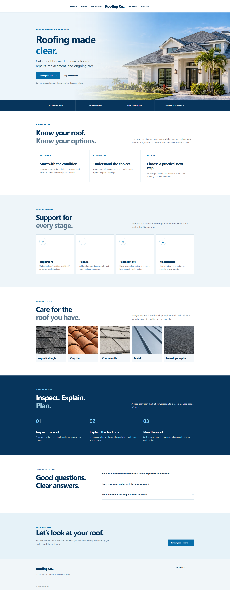

# PageSpeed record: October 28, 2026

## Result

Google PageSpeed Insights reported a Lighthouse Performance score of **100 on mobile** and **100 on desktop** for the internal WordPress test site. The report was generated October 28, 2026 at 12:16:47 PM CDT.

| Device profile | Performance | Accessibility | Best Practices | SEO | FCP | LCP | TBT | CLS | Speed Index |
| --- | ---: | ---: | ---: | ---: | ---: | ---: | ---: | ---: | ---: |
| Mobile | 100 | 100 | 96 | 92 | 0.8 s | 1.2 s | 0 ms | 0 | 1.9 s |
| Desktop | 100 | 100 | 96 | 92 | 0.3 s | 0.3 s | 0 ms | 0 | 0.5 s |

The timestamped PageSpeed screenshots below retain the captured report details. 

## Test setup

- Site: internal hosted WordPress 7.1.3 installation with the BlueRoof WP Theme active and no added plugins.
- Homepage: generic roofing content set as the static front page, with repair, replacement, inspection, maintenance, process, roof-material, FAQ, and contact sections.
- Images: seven WebP files added to the Media Library. The homepage hero and five roof-material images were confirmed loaded before visual capture.
- Lighthouse: 13.5.0, initial page load, custom throttling.
- Field data: PageSpeed Insights reported no CrUX field data for this URL.

## Audit notes

- Mobile image delivery showed an estimated 63 KiB of possible savings, about 120 ms of render-blocking requests, and about 16 KiB related to cache lifetime.
- Desktop image delivery showed an estimated 135 KiB of possible savings, about 24 KiB related to cache lifetime, and one long main-thread task.
- Best Practices scored 96 because the report logged a browser console error. The test session recorded a 404 for the theme JavaScript asset.
- SEO scored 92. Lighthouse identified the missing meta description.
- These issues describe the October 28 run. Theme version 0.1.1 packages the asset under a stable theme folder and supplies a fallback description. The update was installed on October 28. The theme script returned HTTP 200, mobile navigation opened correctly, and the homepage included a meta description. These functional checks do not replace the original Lighthouse results above.

These are results from one Lighthouse lab run. Scores and timings can vary by run and testing conditions. Potential savings are estimates, not measured changes to the score.

## Timestamped evidence

Report screenshots were captured after the PageSpeed run. Full-page demo screenshots were captured after scrolling through the page to trigger lazy-loaded images.

| Captured (CDT) | Evidence |
| --- | --- |
| 2026-10-28 12:23 PM | [Mobile PageSpeed report](screenshots/2026-10-28T12-23-CDT_pagespeed-mobile.png) |
| 2026-10-28 12:24 PM | [Desktop PageSpeed report](screenshots/2026-10-28T12-24-CDT_pagespeed-desktop.png) |
| 2026-10-28 12:26 PM | [Desktop internal WordPress capture](screenshots/2026-10-28T12-26-CDT_demo-desktop.png) |
| 2026-10-28 12:27 PM | [Mobile internal WordPress capture](screenshots/2026-10-28T12-27-CDT_demo-mobile.png) |

